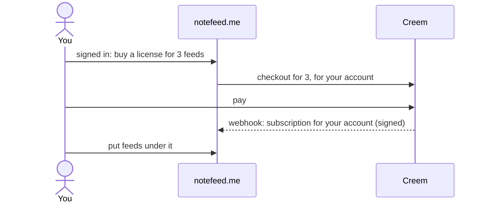

# Free tier and licenses

This page is about [notefeed.me](https://notefeed.me) only. A notefeed you run yourself has no free tier and no licenses: every feature is on, and the limits are [yours to set](../self-hosting/configuration.md).

## The free tier

Every feed on notefeed.me starts on the free tier, with nothing to sign up for:

- **It keeps its newest 100 notes.** Every note counts: a text, a picture kept from a license that ran out, and the mark the operator leaves where a post was removed. At the cap, each new note drops the oldest one; a post is never refused for it.
- **No pictures.** A picture, posted on its own or with a note, is refused with `402` (`license_required`).
- **No feed password.** A [feed password](../using/feed-passwords.md) needs a feed under a license (below). Without one it is refused with `402`. A license needs no password, though: an open feed can be under it too.

The feed's settings show the tier under **License**, as *Free tier · N of 100 notes*, with a meter. From 90 % of the cap on, the feed's page tells whoever can post to it; readers, the read-only view and RSS never see it. Scripts read the same from the [Feeds API](../integrations/api.md): `GET /api/v1/feeds/<feed>` answers `free_tier` as `{ "notes": N, "cap": 100 }`, or `null` for a feed under a license.

## What a license is

A license belongs to an [account](../self-hosting/accounts.md) (a number, no e-mail, no name), by the month or by the year, for as many feeds as you choose; the price per feed is on the [license page](https://notefeed.me/license). Every feed under it keeps every note, can have feed passwords, takes pictures, and its posts, edits and deletes don't count against the per-client rate limit, so a burst from CI is never answered with `429`.

notefeed keeps the subscription's reference at the payment provider, how many feeds it covers, and its end, with the account; nothing about who paid. The payment provider, Creem, holds the purchase.

## Buying

Sign in to your account, or create one (only an account number and a recovery key), then on the [license page](https://notefeed.me/license) choose how many feeds it covers and a plan. After paying you come back to the account page, which shows the license once Creem confirms it. Buying again later adds another subscription; the numbers add up. Scripts and agents use `POST /api/v1/account/license/checkout` with `{"period": "month" | "year", "units": 3}` and an [account token](../self-hosting/accounts.md#account-tokens), the MCP tool `buy_license`, or `buyLicense` / `buy_license` in the [clients](../integrations/clients.md): the answer is the URL to pay at.

## Which feeds it covers

A feed goes under the license of the account that owns it ([owners](../using/feed-passwords.md#a-feed-with-an-owner)):

- **A feed made while signed in** with a password, with pictures, or without a note goes under it at once, if a unit is free. Without an account, or with every unit taken, that is `402` (`license_required`).
- **Any of your feeds** from its settings: open the **License** row and choose **Put it under your license**, or **Take it off your license** to free the unit for another feed. Over the API: `PUT` or `DELETE /api/v1/feeds/<feed>/license`; the clients have `setFeedLicensed` / `set_feed_licensed`, and MCP's `update_feed` takes `licensed`.

The account page lists the feeds it covers. Should more feeds be under it than it covers (a subscription lapsed, or fewer units), the ones put there first stay covered and the page names the others.

## More or fewer feeds

On the account page each subscription has its number of feeds: raise it and Creem charges the difference now; lower it and it takes effect without a refund. It can't go below the feeds under the license: take one off first, so nothing loses its cover by guesswork. Over the API: `PUT /api/v1/account/license/subscriptions/<id>` with `{"units": 4}`, MCP's `change_license_units`, or `changeLicenseUnits` / `change_license_units`.

## Cancelling, invoices, payment method

**Cancel, payment and invoices** on the account page opens Creem's customer portal for your purchases: there you cancel, change how you pay or download invoices. Only your signed-in account opens it. Scripts and agents get its address with `GET /api/v1/account/license/portal`.

## When a license ends

When a subscription is cancelled or paused it runs to the end of the paid period; a refund or chargeback of all of it ends it at once, and a partial refund lowers its number. The feeds it no longer covers return to the free tier, and nothing is deleted:

- The notes stay. The cap applies to new notes again: past 100, each new note drops the oldest one.
- Feed passwords that are set keep protecting the feed, but no new one can be added until it is covered again.
- Pictures already posted are still served; new ones are refused.

Deleting your account deletes its feeds and cancels its subscriptions at Creem.
