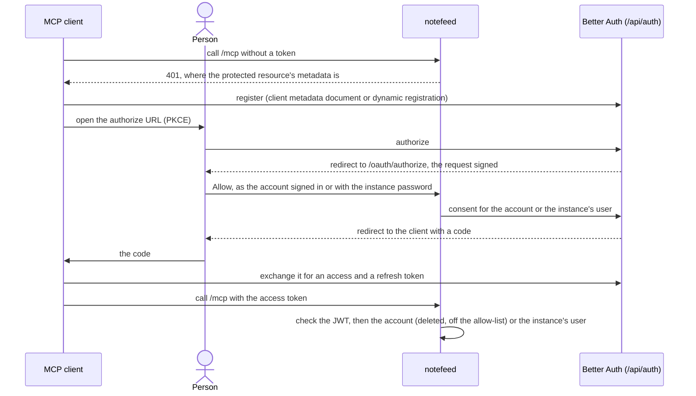

# Passwords and access

## The password

Set `NOTEFEED_PASSWORD` to lock the instance: posting then needs `Authorization: Bearer <password>`, and every page except the login page, the read-only views and the legal pages needs a login. Read links keep working, so feed readers need no change.

```sh
openssl rand -hex 32
```

There is one password for the whole instance. Changing it logs out every browser and breaks every script until you update them. Wrong passwords are rate-limited like posts.

!!! note "Logins don't expire"
    The login cookie stays valid for a year, and logging out only removes it from that browser. If you think a cookie leaked, change `NOTEFEED_PASSWORD`. The cookie is made with the server secret as well as the password, so a leaked one gives away nothing to guess the password from; changing `NOTEFEED_SECRET` logs every browser out too.

A single feed can have a password of its own as well, set by whoever creates it: see [Feed passwords](../using/feed-passwords.md). On a locked instance a protected feed needs both.

The instance password and [accounts](accounts.md) don't go together: notefeed refuses to start with both. An identity provider counts as accounts.

## Accounts

Optional, and off unless `NOTEFEED_ACCOUNTS` (or an identity provider) is set: an account is a generated number with a recovery key and passkeys, no e-mail and no name. With `open` anyone may create one and the instance stays open; `provider` and `closed` lock it. See [Accounts](accounts.md).

## Sign-in

Optional, and off unless the `NOTEFEED_OIDC_*` variables are set: people sign in through your OpenID Connect provider and their notes carry a sender. A sign-in through a provider is an account. See [Sign-in and sender](sign-in/index.md).

## Reserved feeds

For feeds that only the operator posts to but everyone may subscribe to, such as `news` or `announcements`:

```yaml
NOTEFEED_RESERVED_FEEDS: news,announcements
NOTEFEED_RESERVED_PASSWORD: a-long-operator-password
```

At start-up each listed name that doesn't exist yet is created as a [protected feed](../using/feed-passwords.md#in-the-api) with that password, and its read id is its name: `/r/news/feed.xml` is the link to hand out, and it never changes. Nobody else can create a listed name (`400`, `reserved_feed`). Without the password the names are blocked but the feeds don't exist. A name that already exists as an open feed is not converted: delete its folder and restart. Where licenses are sold, a reserved feed counts as licensed: it keeps every note, takes pictures and has no free-tier cap.

With [accounts](accounts.md), reserved feeds belong to your account instead: set `NOTEFEED_OPERATOR_ACCOUNT` to its number. Each listed name that doesn't exist yet is created at start-up owned by it, open until you give it [feed passwords](../using/feed-passwords.md#a-feed-with-an-owner) on its settings page (one per script, such as "GitHub releases"); `NOTEFEED_RESERVED_PASSWORD` is not used. Without `NOTEFEED_OPERATOR_ACCOUNT` none are created, and start-up says so. A reserved feed that exists from before, protected by the reserved password, keeps it; give it to your account with the operator's [feeds endpoint](accounts.md#feeds-and-their-owners).

A reserved name is not linked anywhere by itself, so you can hold back names (`admin`, `www`) that you never post to. To link feeds in every page's footer and the ⓘ menu, name them in `NOTEFEED_FOOTER_FEEDS`, in the order they should appear, reserved or not:

```yaml
NOTEFEED_FOOTER_FEEDS: news,announcements
```

Each link goes to the feed's read link and shows the feed's title, or its name. A name that is no feed is left out.

## OAuth for MCP clients

Clients that can't send a header, such as the Claude.ai and Claude Desktop connectors for [MCP](../integrations/mcp.md), log in through OAuth: Better Auth's OAuth server, on every instance that is locked or has accounts, with `PUBLIC_URL` set (`https://`).

- **Locked by `NOTEFEED_PASSWORD`:** the authorize page asks for the instance password (the failed-attempt limit applies). The client then acts as the instance, as the password would. Changing `NOTEFEED_PASSWORD` ends every client at the next start; they log in again.
- **With [accounts](accounts.md):** the client signs in as an account ([MCP](../integrations/mcp.md#as-an-account)).

A connector's first sign-in, top to bottom. The person answers on notefeed's authorize page in their browser; the client only ever sees the code and the tokens.



The issuer is `<PUBLIC_URL>/api/auth`, found from `/.well-known/oauth-authorization-server` and `/.well-known/oauth-protected-resource/mcp`. A client registers itself, by its client metadata document or by dynamic registration (Claude.ai needs that); registrations count toward the [rate limit](limits.md). The clients, what was allowed and the refresh tokens are kept in `accounts.sqlite` (`NOTEFEED_ACCOUNTS_DB`), also on an instance without accounts: back it up with your data. An access token is a signed JWT for `<PUBLIC_URL>/mcp` that lasts an hour; a refresh token lasts 30 days from its last use and works once. Without `PUBLIC_URL` there is no OAuth, and a client sends `Authorization: Bearer <password>`. An open instance without accounts takes everyone on `/mcp`.
