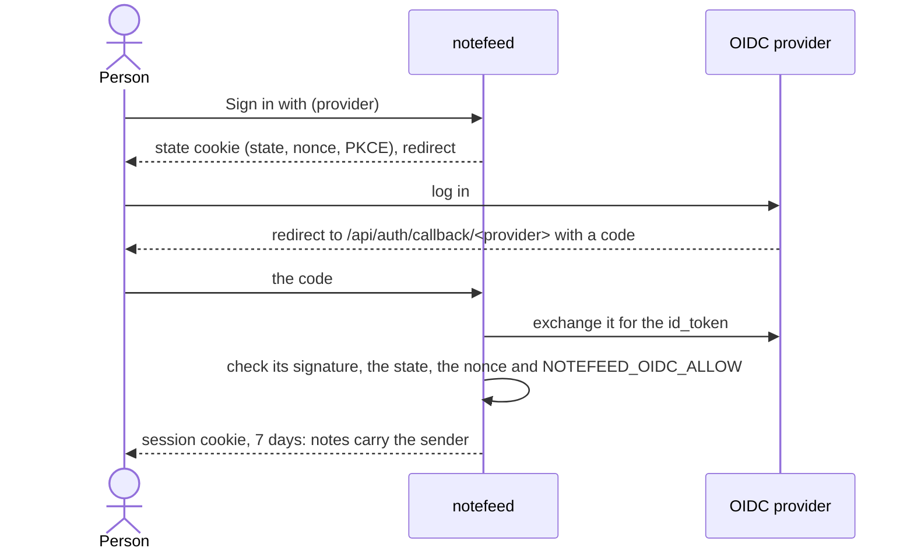

# Sign-in and sender

!!! info "notefeed is private by default"
    notefeed stores nothing about a person: no accounts, no profiles. Sign-in is **opt-in**, switched on only by the `NOTEFEED_OIDC_*` variables (see [Setup](setup.md)).

With sign-in on, people log in through your own OpenID Connect provider (Authentik, Keycloak, Google and the like, one or several) instead of sharing the instance password, and the notes they post carry their name as a **sender**. Read links, RSS, feed passwords and scripts work as before. You want it when a team shares one instance and wants to see who posted what, or when each person should authorise [MCP](../../integrations/mcp.md) clients with their own account. A single person, or scripts, need nothing from it.

A sign-in, top to bottom. notefeed runs it with [Better Auth](https://better-auth.com), which keeps the person and the sign-in in a file of its own, `accounts.sqlite` (see [The sender](#the-sender)):

## The sender

The sender is one field in the note's metadata (the `.json` file next to the note, or its database row): by default the first non-empty claim of `NOTEFEED_OIDC_SENDER_CLAIM` (the `name`, else the `email`). A note can also be posted with a sender of its own, from a script or the composer; the sender is a label, not a proof of who posted.

Sign-in keeps the person in `accounts.sqlite` (`NOTEFEED_ACCOUNTS_DB`, apart from the notes on every storage backend): their name from the provider, their e-mail address (or a placeholder when the provider gives none), the provider's id for them, and their sessions, each valid for 7 days from signing in. None of the provider's tokens is kept. Back the file up with the data ([Backups](../backups.md)).

The sender shows on the feed page, in the read-only view, in RSS as `<dc:creator>` and in the API as `sender`. A feed's **Show who posted** setting (`show_sender` in the [settings API](../../using/feeds.md#feed-settings-in-the-api)) hides it from readers; the feed page behind your password still shows it.

!!! warning "A copy can't be recalled"
    A note already fetched by an RSS reader keeps the sender it had. Turning the setting off hides it from now on, nothing more.

## Scripts and passwords

`NOTEFEED_PASSWORD` keeps working as a bearer token, and a note posted with it has no sender. Sign-in alone locks the instance to signed-in people, so set a password as well if scripts need to post.

## MCP

The OAuth authorize page that MCP clients open has a **Sign in with** button for each provider next to the password field. A client authorised that way posts with the person's sender.

## Removing a person

Take them off the allow-list and restart: they can no longer sign in, and what they already signed in with runs out within 7 days. To sign everyone out at once, change `NOTEFEED_SECRET` (or `NOTEFEED_PASSWORD`). To remove what sign-in keeps about them, with notefeed stopped: `sqlite3 accounts.sqlite "pragma foreign_keys = on; delete from user where email = 'ann@example.com'"` (their sessions and provider id go with it). Their notes keep the `sender` line until you delete the notes or edit it out of the files.

## Privacy page and imprint

A sender name or e-mail address is personal data, and as the operator you are its controller. Before you switch sign-in on, make your [privacy page](../legal-pages.md) say that notefeed keeps the signed-in person's name and e-mail address in its sign-in file, that notes carry their name or address, that it is shown on the public read link and in RSS unless the feed hides it, and how a person can have it removed.
